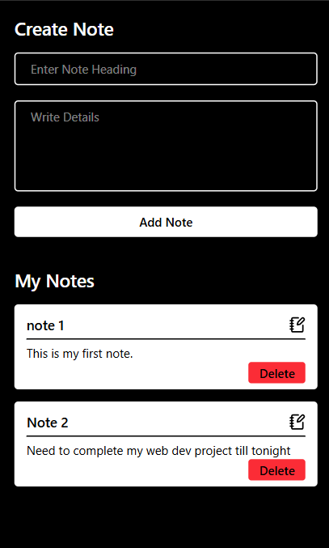
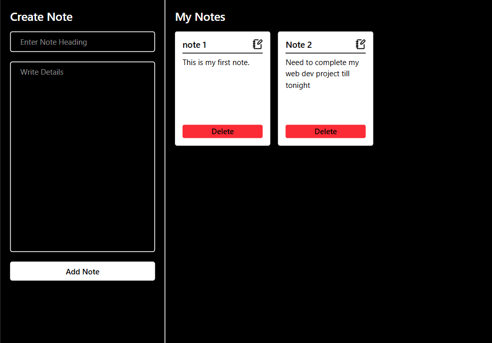
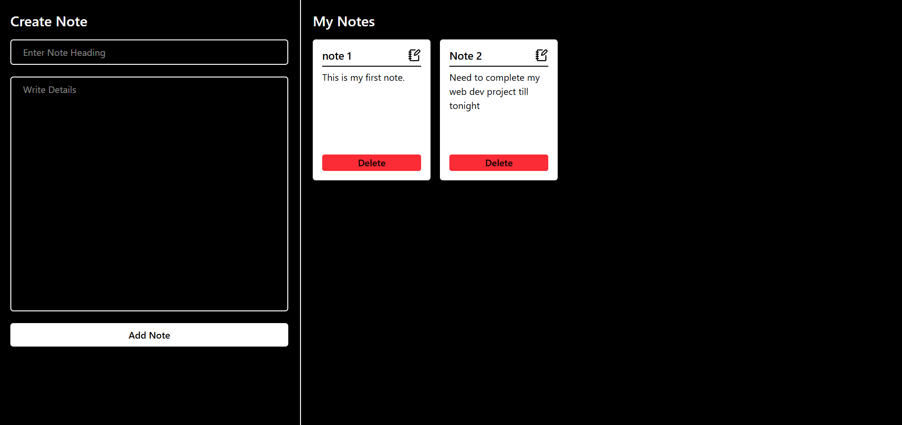

# 📝 Notes App

A simple, responsive, and user-friendly **Notes App** built with React and Tailwind CSS. This application allows users to create, view, edit, and delete notes with data stored in the browser's Local Storage, ensuring notes remain available even after refreshing the page.

## 🚀 Features

- ➕ **Create Notes** — Add notes with a heading and detailed description.
- 📋 **View Notes** — Display all saved notes in an organized card layout.
- ✏️ **Edit Notes** — Update existing notes whenever needed.
- 🗑️ **Delete Notes** — Remove notes that are no longer required.
- 💾 **Local Storage** — Automatically persist notes in the browser without requiring a backend.
- 📱 **Responsive Design** — Adapt the interface to different screen sizes, including mobile, tablet, and desktop.
- 🎨 **Clean UI** — Minimalist black-and-white interface with clearly visible buttons and note cards.

## 🛠️ Technologies Used

- **React.js** — Building the user interface with reusable components.
- **Tailwind CSS** — Styling the application and creating a responsive layout.
- **JavaScript (ES6+)** — Implementing application functionality.
- **HTML5** — Structuring the application.
- **Local Storage API** — Saving notes in the browser.
- **Vite** — Development server and build tool, if used in your project setup.

## 📸 Application Preview

The application features a simple interface with two main sections:

- **Create Note:** Enter a note heading and write the details.
- **My Notes:** View your saved notes, edit their content, or delete them.

### Mobile View

Designed to provide a compact and user-friendly experience on mobile screens.



### Tablet View

The note creation form and saved notes are displayed in a side-by-side layout when sufficient space is available.



### Desktop View

A spacious two-column layout allows users to create notes and manage existing notes efficiently.



## ⚙️ Installation and Setup

Follow these steps to run the project locally.

### 1. Clone the Repository

```bash
git clone https://github.com/YOUR-USERNAME/YOUR-REPOSITORY-NAME.git
```

Replace `YOUR-USERNAME` and `YOUR-REPOSITORY-NAME` with your GitHub username and repository name.

### 2. Navigate to the Project Directory

```bash
cd YOUR-REPOSITORY-NAME
```

### 3. Install Dependencies

```bash
npm install
```

### 4. Start the Development Server

If your project uses Vite, run:

```bash
npm run dev
```

Open the local URL displayed in your terminal to use the application.

### 5. Build for Production

```bash
npm run build
```

## 💡 How to Use

1. Open the Notes App in your browser.
2. Enter a title in the **Enter Note Heading** field.
3. Write your note in the **Write Details** text area.
4. Click **Add Note** to save the note.
5. View your saved notes in the **My Notes** section.
6. Use the edit icon to modify a note.
7. Click **Delete** to remove a note.

Your notes are saved in the browser's Local Storage, so they remain available after refreshing the page in the same browser.

## 💾 Data Storage

This application uses the browser's **Local Storage API** to persist notes.

### Benefits

- No backend or database is required.
- Notes remain saved after a page refresh.
- Data is stored locally in the user's browser.
- Notes can be accessed again from the same browser and origin.

**Note:** Local Storage is browser-specific. Clearing browser data, switching browsers, or using a different device may result in notes being unavailable. The application does not automatically synchronize notes across devices.

## 📂 Project Structure

The project structure may vary depending on your implementation. A typical Vite and React setup looks like this:

```text
notes-app/
├── src/
│   ├── assets/
│   ├── components/
│   ├── App.jsx
│   ├── App.css
│   ├── index.css
│   └── main.jsx
├── index.html
├── package.json
├── package-lock.json
├── vite.config.js
└── README.md
```

## 🎯 Project Objectives

- Build a functional notes application using React.
- Practice React components, state management, and event handling.
- Implement Create, Read, Update, and Delete (CRUD) functionality.
- Use Tailwind CSS to build a responsive user interface.
- Understand how to store and retrieve data using Local Storage.
- Improve practical frontend development skills.

## 🔮 Future Improvements

Potential enhancements for future versions include:

- 🔍 Search notes by title or content.
- 🏷️ Add categories and tags.
- 📌 Pin important notes.
- 🌙 Add a light and dark theme toggle.
- 📅 Display note creation and modification dates.
- 📤 Export and import notes.
- ☁️ Add user authentication and cloud synchronization.

## 👨‍💻 Author

**Ankit Gangwar**

- GitHub: [github.com/ankitgangwar0012](https://github.com/ankitgangwar0012)

## 📄 License

This project is open-source and available for learning and personal use.

---

⭐ **If you find this project useful, consider giving the repository a star!**
